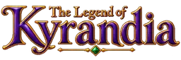

# KyraWeb



**English** · [Русский](README.ru.md)

[Play in your browser](https://yanakulov.github.io/kyraweb/)

KyraWeb is an unofficial web remake of *The Legend of Kyrandia*, the first book of Westwood Studios’ *Fables & Fiends* series (1992). It pairs the original pixel art, animation, and game scripts with a new 3D storybook interface.

## What you can play

- Open the book to read the prologue and enter the intro. After the Westwood and AkulaFlow logos, the cutscene leads to Kallak’s desk and the **Start Journey** menu.
- Follow Brandon into his home, discover what happened to Kallak, and speak to the tree. The tree conversation plays on your first attempt to leave if you haven’t spoken to it yet.
- Explore the first forest region and complete the original quest chain through the bridge repair. Visit Brynn, heal the willow, follow Merith, find the amulet, and bring Herman the saw. You can cross the repaired bridge and return.
- Continue into the Timbermist Woods. Meet Darm, Brandywine, and Nolby, plant the three seeds, and use the amulet to heal the songbird. Bring Darm the feather and collect his magic scroll.

- Solve the birthstone puzzle at the marble altar, recover the flute, and confront Malcolm at Serpent's Grotto.
- Explore Shadowrealm with fireberries, unlock the purple jewel, recover the gold key and reach the plateau beyond the Chasm of Everfall.
- Continue into Faeriewood, meet Zanthia, restore the Enchanted Fountain and awaken the blue jewel. Pick fresh blueberries, explore the woods behind Zanthia’s laboratory and mix potions at the Crystals of Alchemy. Bargain with the Faun for the Royal Chalice and fly as Pegasus to the island of Castle Kyrandia. Meet Queen Katherine’s ghost, sneak past the gargoyles and face Malcolm in the castle entry hall.
- Explore the castle’s halls and kitchen, solve the library’s book puzzle and ride the revolving fireplace. Break the catacomb barrier with the blue jewel, light the tunnels in wisp form and recover the first gold key.
- Climb to the upper floor, deal with Herman and play the Music Room bells to reveal the second key. Open the Royal Foyer with both keys and place the regalia to open the Kyragem chamber.
- Face Malcolm in the Kyragem chamber. Reflect his spell, restore the Kyragem and watch the original CD epilogue and scrolling credits.

The game has English and Russian text and original English CD voices.

## Controls and saves

On desktop, point and click to move or interact. On a touchscreen, swipe to guide the persistent cursor and tap to act at its position. The cursor becomes a directional arrow over an open exit. During dialogue, click or tap to advance the current line.

**Options** pauses the game and pulls the camera back to the book. Use it to resume, change language or walk speed, replay the intro, or save and load. Three manual slots and one autosave stay in the current browser. The autosave updates at safe points such as room arrivals and completed scenes. After a fatal mistake, the book lets you continue from the last autosave.

Open **Settings → Dev Menu** to test any room, a room variant, an intro scene, or a story checkpoint. Test sessions use separate game state and leave your saves intact.

## Music and sound effects

After opening the book, choose **Sound settings** to adjust music, effects, and voices independently before the intro. In-game, the same controls are under **Settings**. Voice recordings load by scene and follow the subtitle skip control.

- **AdLib (OPL2)** is enabled by default. It synthesizes the original DOS score in real time from Westwood's AdLib banks and requires no ROM or SoundFont. [Music setup](docs/music.md)
- **Roland MT‑32 / CM‑32L** uses Munt to synthesize the original DOS CD XMIDI music and effects in real time. Import your own matching Control and PCM ROM pair. The browser stores it locally. For localhost development or preview, you can also use the private `.local/mt32/` directory. [MT‑32 setup](docs/music.md)
- **GeneralUser GS** downloads on selection, with progress shown in Settings. You can also import an `.sf2` bank. This mode uses approximate General MIDI instrument mapping for the score. [SoundFont setup](docs/soundfonts.ru.md)

The starting mix is 50% music, 25% effects, and 60% voices. Effects work with music off. AdLib and SoundFont modes use a compact recording of the original effects rendered with CM‑32L.

## Run locally

Use Node.js 20 and npm.

```sh
npm ci
npm run dev
```

Open the URL printed by Vite, normally [localhost:5173/kyraweb/](http://localhost:5173/kyraweb/). The repository includes the converted assets needed to run the game. The GOG installation is needed only to rebuild those assets from the original files.

```sh
npm test
npm run typecheck
npm run build
npm run check:size
```

## Engine and resources

The web app uses Vue, TypeScript, and Vite. Three.js renders the book and its transitions. Game scenes use indexed Westwood graphics with their original palettes, compressed into packs and loaded by scene. WebGL2 handles palette lookup, with Canvas 2D as a fallback.

- [Forest map, room transitions, and quest scripts](docs/world.md)
- [Movement and walk masks](docs/movement.md)
- [Scene animation](docs/animations.md) and [subtitle timing](docs/subtitles.md)
- [Indexed resource format](docs/resources.md) and [import tools](extractor/README.md)

Original game by Westwood Studios, 1992. Web remake by AkulaFlow · Yan Akulov.
