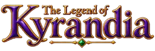
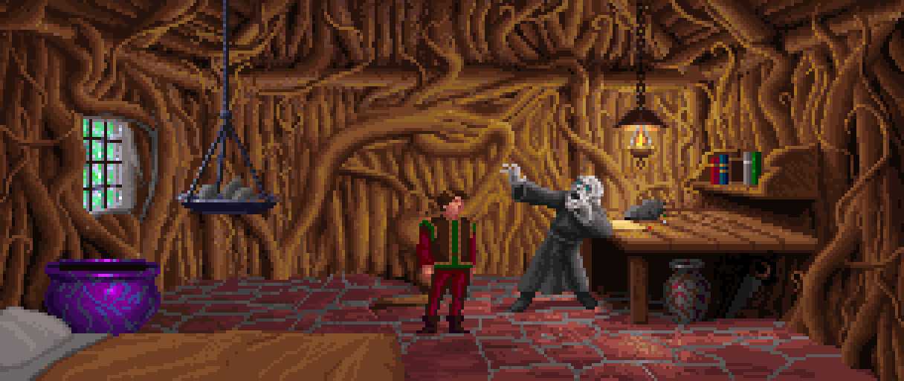
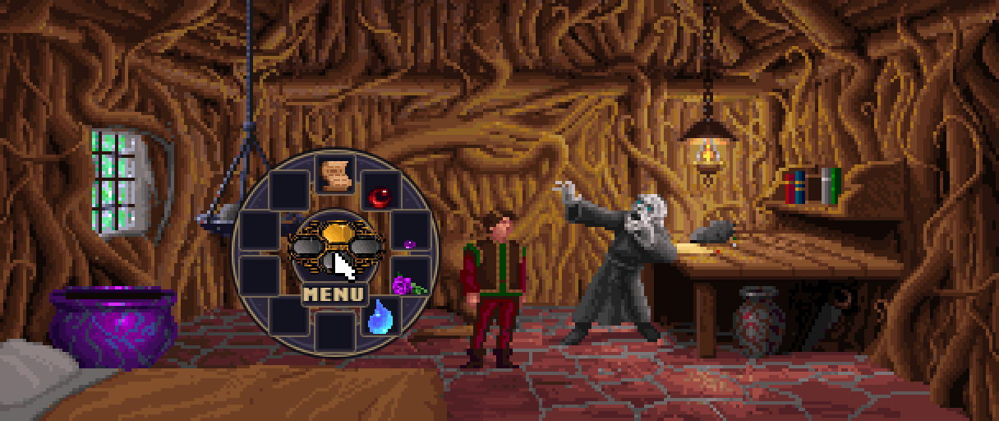
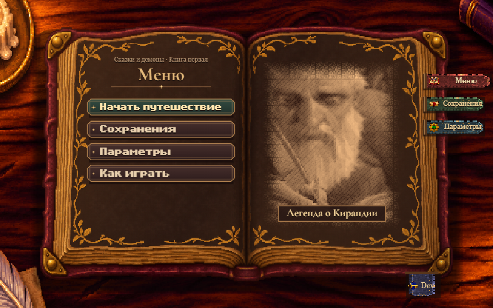
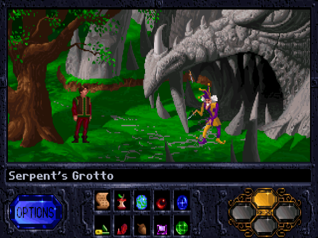

# WebKyra



[Играть](https://lok.akulaflow.ru/) · [Вики движка](https://lok.akulaflow.ru/howitworks/) · [Английская вики](https://lok.akulaflow.ru/howitworks/en/) · [English README](README.md)

Проект переносит первую *The Legend of Kyrandia* в браузер. Игру можно пройти целиком, от подъёмника у дома Брендона до финала и титров CD-издания. Графика, анимации, сценарии и звуковые данные взяты из игры Westwood. **WebKyra** исполняет их своим кодом на TypeScript.

## Скриншоты







Оригинальный интерфейс DOS. [Кадр из галереи ScummVM](https://www.scummvm.org/screenshots/westwood/kyra/).



## Как играть

Откройте пиксельную книгу. При первом запуске она предложит выбрать управление и настроить звук. В ней же находятся пролог, настройки языка, три ручных сохранения и автосохранение. Сохранения остаются в браузере.

| | Компьютер | Сенсорный экран |
|---|---|---|
| Идти и взаимодействовать | Навести курсор и щёлкнуть | Свайпом подвести курсор и коснуться экрана |
| Открыть круговой инвентарь в современном режиме | Правая кнопка мыши | Касание двумя пальцами |
| Пропустить текущую реплику | Щелчок во время разговора | Касание во время разговора |

В классическом режиме инвентарь и кнопка «Меню» находятся на оригинальной панели. В современном режиме сцене отдано место этой панели, а кнопка «Меню» находится в круговом инвентаре. В обоих режимах меню возвращает к книге. Текст доступен на русском и английском, озвучка взята из английского CD-издания.

В **Dev Menu** можно запустить отдельную комнату, её вариант или сюжетную сцену в тестовом сеансе. Трёхмерная версия книги доступна по адресу [`?book=3d`](https://lok.akulaflow.ru/?book=3d).

## Звук

- **AdLib (OPL2)** работает по умолчанию. Оригинальную музыку в браузере синтезируют драйвер, совместимый с Westwood, и Nuked OPL3. Дополнительные файлы не нужны.
- **Roland MT-32 / CM-32L** использует Munt для музыки и эффектов. Загрузите совместимую пару Control ROM и PCM ROM. Файлы останутся в браузере.
- **SoundFont** использует TinySoundFont с приблизительным сопоставлением тембров MT-32 и General MIDI. Можно скачать GeneralUser GS в настройках или загрузить свой `.sf2`.

Громкость музыки, эффектов и голосов настраивается отдельно. [Устройство звука и установка ROM](docs/music.ru.md)

## Локальный запуск

Понадобятся Node.js 20 и npm.

```sh
npm ci
npm run dev
```

Откройте адрес, который напечатает Vite, обычно это [localhost:5173/kyraweb/](http://localhost:5173/kyraweb/). Подготовленные ресурсы уже в репозитории. Чтобы собрать пакеты из оригинальных файлов, нужна локальная DOS CD-версия игры, например из GOG.

```sh
npm test
npm run typecheck
npm run build
npm run check:size
```

## Документация движка

- [Вики с примерами](https://lok.akulaflow.ru/howitworks/) показывает смену палитр, маски глубины, изменения между кадрами, звук и размеры сборки.
- [Формат ресурсов](docs/resources.md) и [инструменты импорта](extractor/README.ru.md) описывают подготовку игровых файлов.
- [Комнаты и сценарии](docs/world.md), [движение](docs/movement.ru.md), [анимации](docs/animations.ru.md) и [субтитры](docs/subtitles.ru.md) описывают работу движка.

Оригинальная игра © 1992 Westwood Studios. Веб-версию сделал [Ян Акулов, AkulaFlow](https://akulaflow.ru/lab/kyraweb).
